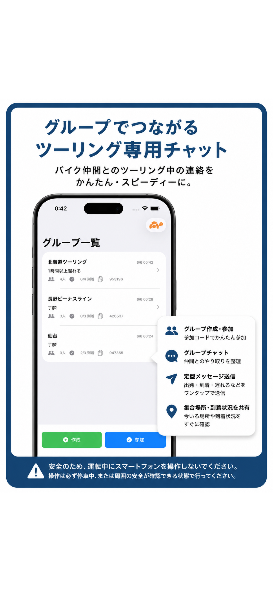
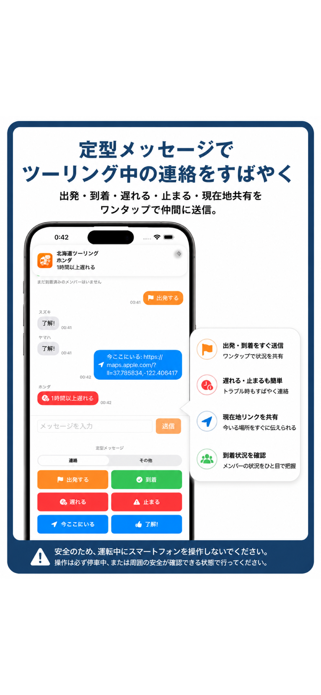
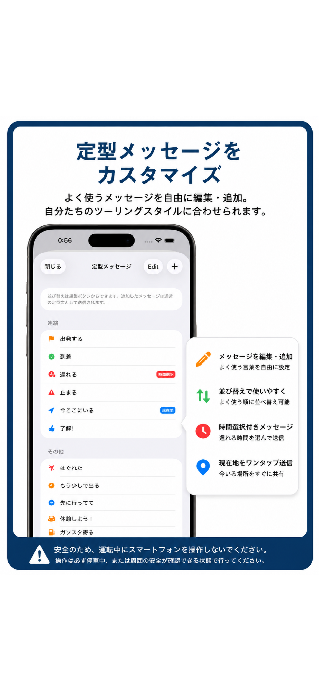

# ツーリングチャット

バイク仲間とのツーリング中の連絡を、短く・素早く・分かりやすくするためのiOSグループチャットアプリです。

[App Storeで公開中](https://apps.apple.com/jp/app/%E3%83%84%E3%83%BC%E3%83%AA%E3%83%B3%E3%82%B0%E3%83%81%E3%83%A3%E3%83%83%E3%83%88/id6776994661)

> 安全のため、運転中のスマートフォン操作は想定していません。操作は必ず停車中、または周囲の安全を確認できる状態で行ってください。

## アプリ概要

ツーリングでは「出発する」「到着」「遅れる」「止まる」など、同じ内容を何度も共有します。本アプリは、こうした連絡を定型メッセージとしてワンタップで送信できるようにし、グループ内の状況確認を簡単にします。

## 主な機能

- 6桁の参加コードによるグループ作成・参加
- Firestoreを利用したリアルタイムチャット
- 出発・到着・遅延・停止などの定型メッセージ送信
- 定型メッセージの追加、編集、並べ替え
- Apple MapsのURLを利用した現在地共有
- メンバーの到着状況確認
- FCMとAPNsを利用したメッセージ通知
- 招待URLの共有とアプリ内参加導線
- 表示名、プロフィールカラー、アイコンの設定

## スクリーンショット

<p align="center">
  
  
  
</p>

## 使用技術

- Swift / SwiftUI
- Firebase Authentication（匿名認証）
- Cloud Firestore（グループ、メンバー、メッセージの同期）
- Firebase Cloud Functions（Firestoreイベントを起点とする通知処理）
- Firebase Cloud Messaging / APNs
- Core Location / Apple Maps URL
- UserDefaults（端末内設定と参加グループ情報）
- Swift Package Manager

## 実装のポイント

### リアルタイム同期

Firestoreのスナップショットリスナーを使用し、グループ、メッセージ、到着状況の変更を画面へ即時反映しています。

### 匿名認証

登録画面を設けず、Firebase Authenticationの匿名認証で利用を開始できます。認証UIDと端末内IDを用途に応じて使い分けています。

### プッシュ通知

メッセージ作成をCloud Functionsで検知し、送信者以外のメンバーへFCM経由で通知します。iOS端末への最終配信にはAPNsを使用します。

### 現在地共有

位置情報を取得し、緯度・経度をApple Mapsで開けるURLへ変換してチャットに投稿します。

## 担当範囲

個人開発として、企画、要件整理、UI設計、実装方針の決定、Firebase構築、実機・シミュレーターでの検証、App Store Connectでの申請と公開まで担当しました。開発では生成AIも活用し、提案されたコードを実機で検証しながら、要件に合うよう修正と改善を重ねました。

## プロジェクト構成

```text
touring app/                    iOSアプリ本体
touring watch app Watch App/    Apple Watch向け試作コード
firebase-functions/             通知用Cloud Functions
firestore.rules                 Firestoreセキュリティルール
AppStoreScreenshots/            App Store掲載画像
```

Apple Watch向けコードは試作段階であり、現在公開中のバージョンには含めていません。

## ローカルでの起動

1. このリポジトリをクローンします。
2. `touring app.xcodeproj` をXcodeで開きます。
3. FirebaseでiOSアプリを作成し、Authenticationの匿名認証、Firestore、Cloud Messagingを有効にします。
4. Firebaseから取得した `GoogleService-Info.plist` を `touring app/` に配置します。
5. XcodeのSigning & Capabilitiesで自分のTeamとBundle Identifierを設定します。
6. 必要に応じて `firestore.rules` と `firebase-functions/` を自身のFirebaseプロジェクトへデプロイします。
7. iPhoneシミュレーターまたは実機で実行します。

設定ファイルの項目例は `GoogleService-Info.plist.example` を参照してください。実際のFirebase設定、証明書、秘密鍵、個人用Xcodeデータはリポジトリに含めていません。

## 公開範囲

このリポジトリはポートフォリオおよび技術確認を目的として公開しています。オープンソースライセンスは付与していません。無断での再配布、商用利用、アプリの複製はご遠慮ください。

